# 📊 Superstore Sales Dashboard | Power BI

An interactive, multi-page Power BI dashboard that analyzes Superstore sales and profitability from **2011 to 2014**. It covers overall performance, time trends, regions, categories, customers, shipping, and products, so business users can see what makes money and what loses it.

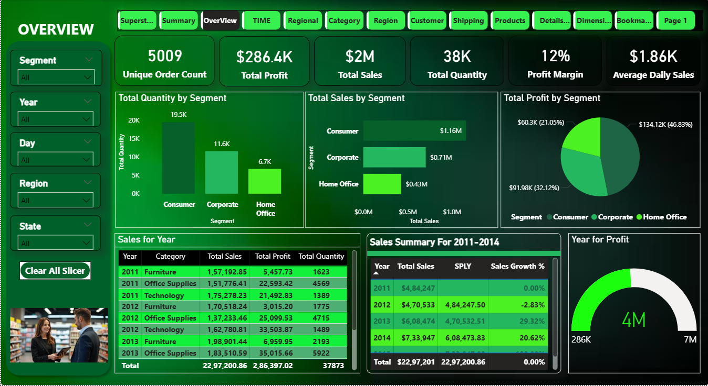

---

## 🎯 Project Objectives
- Track sales, profit, and profit margin over time
- Compare performance across **Central, East, South, and West** regions, and down to state and city level
- Find top-selling and loss-making categories, sub-categories, and products
- Understand customer and segment behavior
- Analyze shipping mode usage
- Let users explore everything with slicers, drill-downs, and page navigation

## 📁 Dataset
- **Source:** Superstore Sales dataset (Orders)
- **Period:** 2011 – 2014
- **Key fields:** Order Date, Ship Date, Ship Mode, Segment, Region, State, City, Category, Sub-Category, Product Name, Customer Name, Sales, Quantity, Discount, Profit

## 🛠️ Tools & Technologies
- **Power BI Desktop**: report design and visualization
- **Power Query**: data cleaning and transformation
- **DAX**: measures such as Total Sales, Total Profit, Profit Margin %, SPLY, YTD, MTD, and QTD
- **Data Modelling**: fact and dimension tables with relationships and a date table
- **Slicers, Bookmarks & Navigation buttons**: interactivity across pages
- **Field & What-if Parameters**: dynamic dimension/measure switching and a sales threshold slider

## 📌 Headline KPIs (all data)
| KPI | Value |
|---|---|
| Total Sales | ~$2.30M |
| Total Profit | ~$286K |
| Profit Margin | ~12% |
| Total Quantity | 37,873 |
| Unique Orders | 5,009 |
| Customers | 793 |
| Products | 1,841 |
| States / Cities | 49 / 531 |
| Average Daily Sales | ~$1.86K |

---

## 🗂️ Dashboard Pages

### 1️⃣ Data Summary
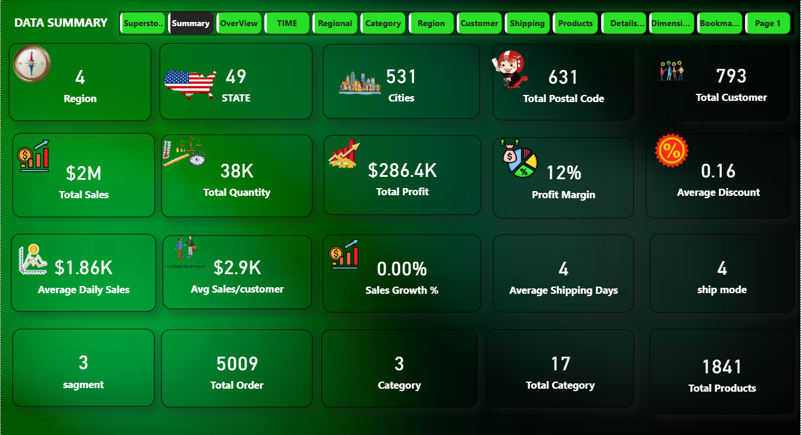
- One-page snapshot of the dataset: 4 regions, 49 states, 531 cities, 631 postal codes, 793 customers, 5,009 orders, and 1,841 products
- Business KPIs: total sales, quantity, profit, profit margin, average discount, average daily sales, and average sales per customer
- Shipping and structure facts: 4 ship modes, about 4 average shipping days, 3 segments, and 3 categories with 17 sub-categories

### 2️⃣ Overview

- KPI cards: **5,009 unique orders, $286.4K profit, ~$2.3M sales, 38K quantity, 12% profit margin, $1.86K average daily sales**
- Quantity, sales, and profit by **customer segment** (Consumer, Corporate, Home Office)
- Sales by year and category table, **sales growth % vs same period last year (SPLY)**, and a profit gauge
- Slicers: Segment, Year, Day, Region, State, plus a Clear All Slicer button

### 3️⃣ Time Analysis
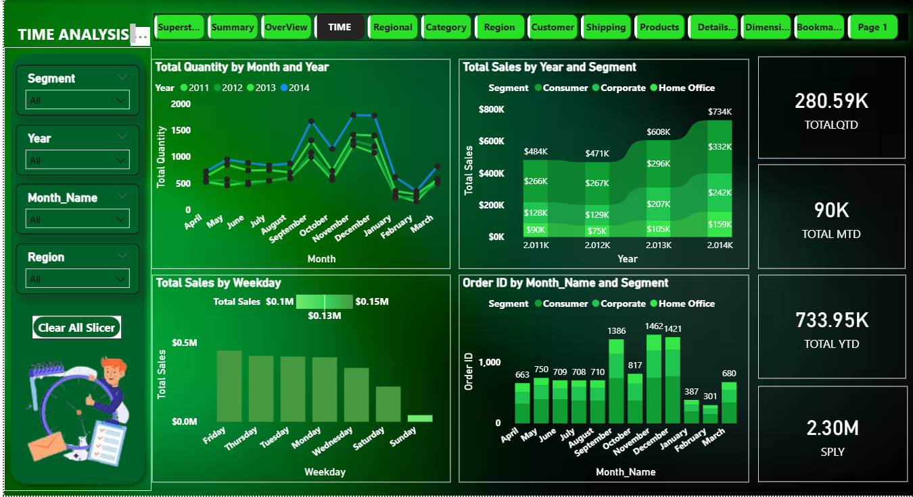
- Monthly quantity trend by year
- Total sales by year and segment (2011 → 2014)
- Total sales by weekday
- Orders by month and segment
- KPI cards: **QTD, MTD, YTD, and SPLY**

### 4️⃣ Regional Analysis
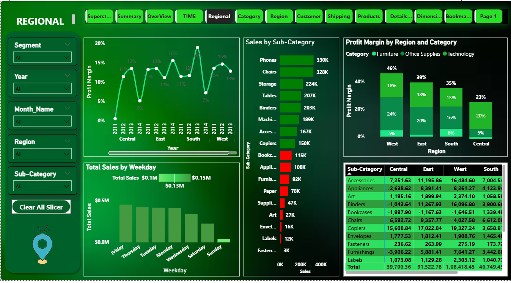
- Profit margin trend by region and year
- Sales by sub-category (lowest sellers highlighted in red)
- Profit margin by region and category
- Profit matrix by sub-category across regions (negative values show losses)

### 5️⃣ Category Analysis
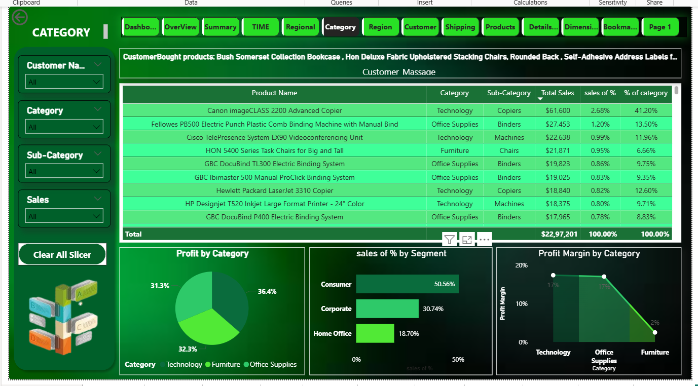
- Product-level table with sales, % of total sales, and % of category
- Profit by category, sales % by segment, and profit margin by category
- Dynamic "Customer Message" text showing products bought by the selected customer

### 6️⃣ Region Details (State & City)
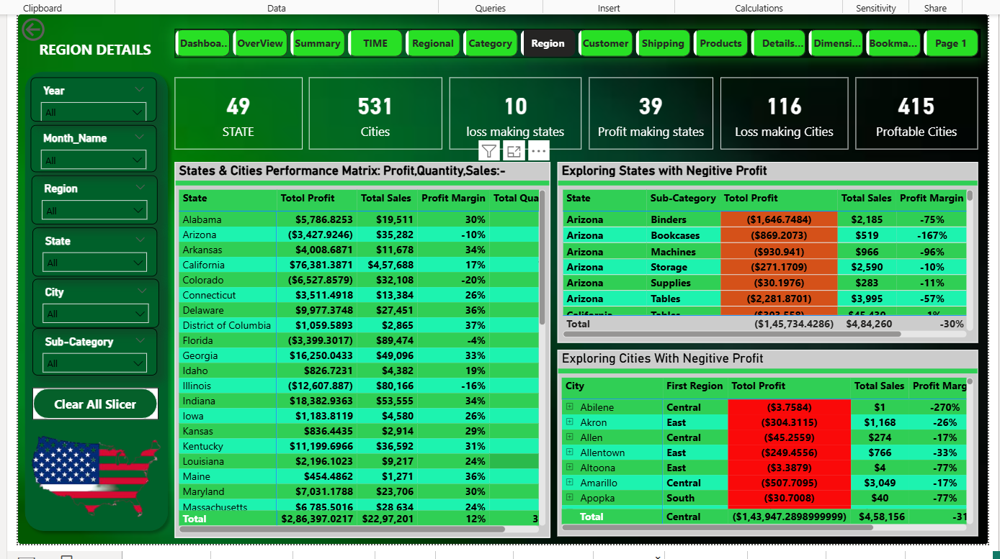
- KPIs: **49 states, 531 cities, 10 loss-making states, 39 profit-making states, 116 loss-making cities, 415 profitable cities**
- State and city performance matrix (profit, sales, margin, quantity)
- Drill-down tables for states and cities with **negative profit**, highlighted with conditional formatting

### 7️⃣ Customers
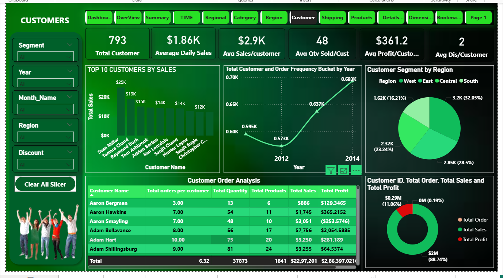
- KPIs: Total Customers, Average Daily Sales, Avg Sales per Customer, Avg Quantity per Customer, Avg Profit per Customer, Avg Discount per Customer
- Top 10 customers by sales
- Customer and order frequency by year
- Orders by region and a customer order analysis table

### 8️⃣ Shipping
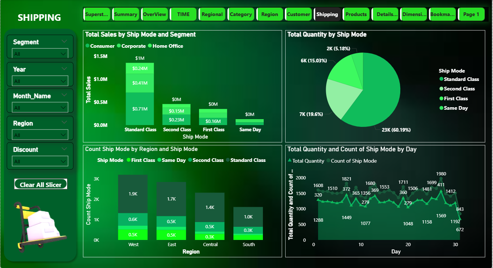
- Sales by ship mode and segment
- Quantity share by ship mode
- Ship mode count by region
- Quantity and ship count by day of the month

### 9️⃣ Products
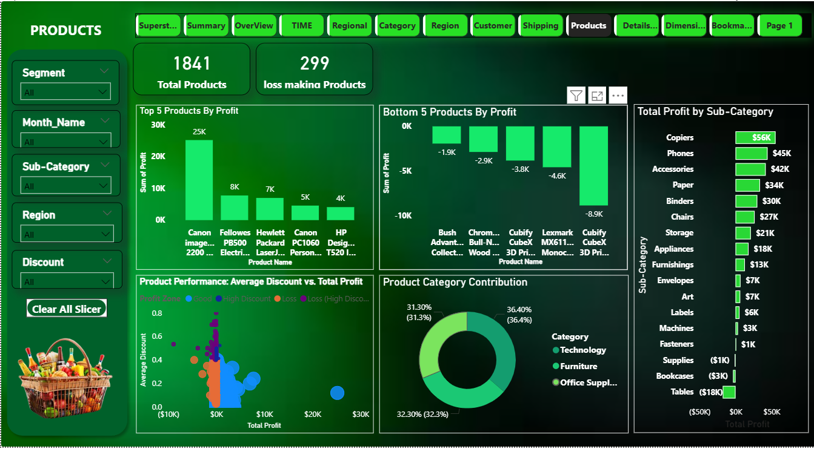
- KPIs: **1,841 total products, 299 loss-making products**
- Top 5 and Bottom 5 products by profit
- Average discount vs total profit scatter plot (profit zones: Good, High Discount, Loss, Loss with High Discount)
- Category contribution and total profit by sub-category

### 🔟 Details
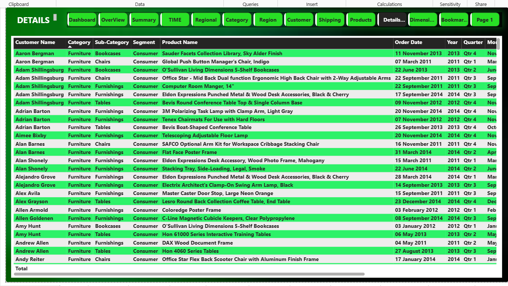
- Row-level detail table: Customer Name, Category, Sub-Category, Segment, Product Name, Order Date, Year, Quarter, and Month
- Lets users look up exactly which customer bought which product and when

### 1️⃣1️⃣ Dimensions (Dynamic Analysis)
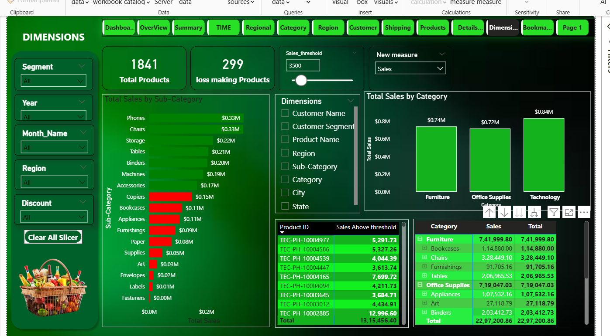
- **Dimension selector** (Customer Name, Customer Segment, Product Name, Region, Sub-Category, Category, City, State) so one visual can be re-cut by any dimension
- **Measure selector** ("New measure") to switch the metric shown
- **Sales threshold slider** (what-if parameter) that lists product IDs with sales above the chosen value
- Total sales by sub-category (below-average sub-categories highlighted in red) and by category
- Expandable category and sub-category sales matrix

### 1️⃣2️⃣ Bookmarks (Switchable Views)
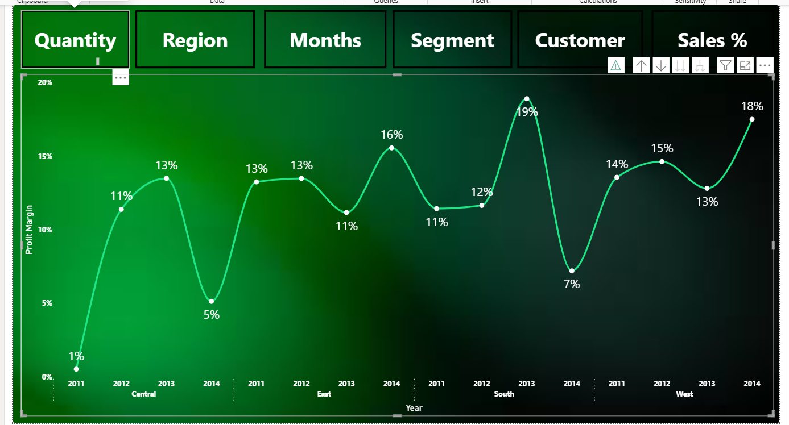
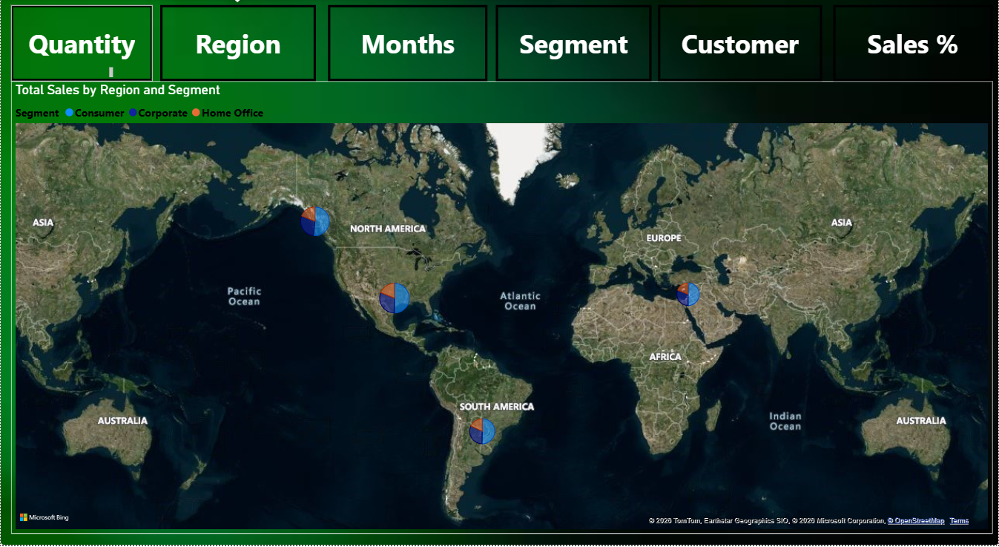
- Bookmark buttons: **Quantity, Region, Months, Segment, Customer, Sales %** switch the view without leaving the page
- Profit margin trend by **region and year** (2011 → 2014)
- Map view of **total sales by region and segment**

---

## 💡 Key Insights

**Sales & Profit**
- Sales grew from about **$484K (2011)** to **$734K (2014)**, with a small dip in 2012 (~$471K) and strong growth in 2013 and 2014.
- Year-over-year sales growth: **-2.83% in 2012**, **+29.32% in 2013**, and **+20.62% in 2014**.
- Overall profit margin is about **12%**.
- **Technology** and **Office Supplies** both earn about a **17%** margin, while **Furniture** earns only about **2%**.

**Time Trends**
- **November, December, and September** are the busiest months by orders; **January and February** are the slowest.
- **Friday** has the highest sales and **Sunday** the lowest.
- Yearly quantity and orders show rising demand in 2014.

**Regions, States & Cities**
- **West** has the highest profit margin in three of the four years (14% in 2011, rising to **18% in 2014**), while **Central** is the weakest in three of four years (1% in 2011, 5% in 2014).
- **South** peaked at **19% in 2013**, then dropped to **7% in 2014**; **East** stayed steady at 11–16%.
- **California** is the biggest profit contributor (~$76K profit, 17% margin).
- Loss-making states include **Illinois, Colorado, Arizona, and Florida**; 10 states and 116 cities are loss-making overall.

**Products & Sub-Categories**
- **Copiers** (~$56K), **Phones** (~$45K), and **Accessories** (~$42K) are the most profitable sub-categories.
- **Tables** (~-$18K), **Bookcases** (~-$3K), and **Supplies** (~-$1K) lose money.
- The top profit product is the **Canon imageCLASS 2200 Advanced Copier** (~$25K); the biggest loss maker is the **Cubify CubeX 3D Printer** (~-$8.9K).
- **299 of 1,841 products** are loss-making. Heavily discounted products fall in the loss zone.

**Customers & Segments**
- **Consumer** is the largest segment (~$1.16M sales, about half of the total), followed by Corporate (~$0.71M) and Home Office (~$0.43M).
- Profit split by segment: **Consumer 46.8%** ($134K), **Corporate 32.1%** ($92K), **Home Office 21.1%** ($60K).
- Top customer: **Sean Miller (~$25K in sales)**.
- Average spend is about **$2.9K per customer**, with about **$361 profit per customer**.

**Shipping**
- **Standard Class** accounts for about **60%** of the quantity shipped; Same Day is only about 5%.
- West has the highest shipment volume of all regions.

## 🔄 Project Workflow
1. Imported the Superstore dataset into Power BI
2. Cleaned and transformed the data in Power Query
3. Built the data model with a date table and relationships
4. Created DAX measures (KPIs, SPLY, YTD, MTD, QTD)
5. Designed a green-themed, multi-page report with navigation buttons
6. Added slicers, conditional formatting, a "Clear All Slicer" button, and drill-down tables
7. Summarized business insights

## 🧮 Sample DAX
```DAX
Total Sales = SUM(Orders[Sales])
Total Profit = SUM(Orders[Profit])
Profit Margin % = DIVIDE([Total Profit], [Total Sales], 0)
SPLY = CALCULATE([Total Sales], SAMEPERIODLASTYEAR('Date'[Date]))
Sales Growth % = DIVIDE([Total Sales] - [SPLY], [SPLY], 0)
```

## 📂 Repository Structure
```
SuperStore_Sales_Analytical_Dashboard/
├── README.md
├── superstore sales dataset.pbix   # Power BI report
├── Ecommerce_Sales_Data.xlsx       # Dataset
├── superstore.pdf                  # Dashboard PDF export
├── SUPERSTORE.png                  # Cover image
├── Summary.png                     # Page screenshots
├── OverView.png
├── Time_analysis.png
├── Regional.png
├── Category.png
├── Regions.png
├── Customers.png
├── Shipping.png
├── Products.png
├── Details.png
├── Dimensions.png
├── Bookmarks.png
└── Segments.png
```

## 🚀 How to Use
1. Download the `superstore sales dataset.pbix` file
2. Open it in **Power BI Desktop**
3. Use the top navigation buttons and slicers to explore each page

## 👤 Author
**Menka Gupta**
🔗 [LinkedIn](https://www.linkedin.com/in/menka-gupta-703486188) | 📧 menkag74@gmail.com | 💻 [GitHub](https://github.com/menkag74-ai)

